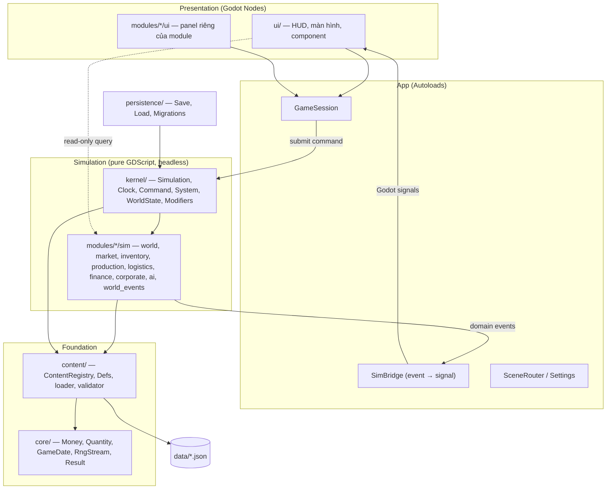

# Kiến trúc source code — World Economy: Build Your Empire

> Tài liệu này mô tả kiến trúc kỹ thuật cho game. Mục tiêu số 1: **thêm tính năng mới (ngân hàng, M&A, IPO, multiplayer...) mà không phải sửa lõi**.
> Engine: Godot 4.x · Ngôn ngữ: GDScript (static typing bắt buộc) · Test: gdUnit4 · Dữ liệu: JSON.

---

## 1. Năm nguyên tắc kiến trúc

| # | Nguyên tắc | Hệ quả cụ thể |
|---|-----------|---------------|
| 1 | **Mô phỏng tách hoàn toàn khỏi giao diện** | Code trong `src/kernel` và `src/modules/*/sim` **không được** `extends Node`, không gọi `get_tree()`, không biết UI tồn tại. Chạy được headless để test và cân bằng. |
| 2 | **Một nguồn sự thật (single source of truth)** | Toàn bộ trạng thái game nằm trong một đối tượng `WorldState`. Báo cáo, KPI, UI đều *đọc* từ đó, không giữ bản sao riêng. Mọi giao dịch tiền đi qua **sổ cái kép** (`Ledger`). |
| 3 | **Mọi thay đổi trạng thái đi qua Command** | Người chơi, AI, tutorial, kịch bản đều gửi `SimCommand`. Nhờ vậy: AI dùng chung luật với người chơi, có replay, có scenario test, và sẵn đường cho multiplayer. |
| 4 | **Dữ liệu điều khiển nội dung (data-driven)** | Quốc gia, hàng hóa, công thức sản xuất, nhà máy, sự kiện, tính cách AI là file JSON trong `data/`. Thêm quốc gia/hàng hóa = thêm file, không sửa code. |
| 5 | **Tính năng là module cắm vào (plugin)** | Mỗi mảng (Market, Production, Finance...) là một module tự đăng ký system, command, state, serializer, UI panel. Tính năng sau 1.0 = thêm một thư mục module mới. |

Thêm các quy tắc kỹ thuật bắt buộc từ hồ sơ concept:
- Tiền dùng **số nguyên fixed-point**, không dùng `float` trong hạch toán.
- Mô phỏng **tất định (deterministic)**: cùng seed + cùng chuỗi command → cùng kết quả.
- Save/load **có version và migration** ngay từ milestone đầu.

---

## 2. Sơ đồ phân lớp



**Quy tắc phụ thuộc** (lớp trên được dùng lớp dưới, không ngược lại):

```
core  ←  content  ←  kernel  ←  modules/*/sim  ←  persistence  ←  app  ←  ui, modules/*/ui
```

- Module sim chỉ phụ thuộc module khai báo trong `get_dependencies()`.
- Module A **không sửa trực tiếp** state của module B. Muốn tác động → gọi *service/command* của B hoặc phát *domain event* để B tự xử lý.
- Có script `tools/lint_architecture.gd` (milestone M0) quét import để bắt vi phạm.

---

## 3. Cấu trúc thư mục

```
WorldEcoGame/
├── project.godot
├── CLAUDE.md                     # Luật làm việc cho Claude Code
├── docs/
│   ├── ARCHITECTURE.md           # (file này)
│   ├── ROADMAP.md                # Lộ trình & backlog
│   ├── DECISIONS.md              # Quyết định kiến trúc/thiết kế (ADR)
│   └── gdd/                      # Game Design Document theo từng mảng
├── addons/                       # gdUnit4, (sau này) godot-sqlite, GodotSteam
├── data/
│   ├── schemas/                  # JSON Schema cho từng loại dữ liệu
│   ├── base/                     # Nội dung gốc của game
│   │   ├── commodities/          # coffee.json, rice.json, crude_oil.json ...
│   │   ├── countries/            # VNM.json, BRA.json, USA.json ...
│   │   ├── recipes/              # Công thức sản xuất (BOM)
│   │   ├── facilities/           # Trang trại, mỏ, nhà máy, kho, cảng
│   │   ├── transport/            # Loại tàu, xe, máy bay, tuyến mặc định
│   │   ├── events/               # Sự kiện thế giới
│   │   ├── ai_profiles/          # Tính cách tập đoàn AI
│   │   ├── scenarios/            # Kịch bản khởi đầu, tutorial
│   │   └── localization/         # vi.csv, en.csv
│   └── mods/                     # (tương lai) mod/DLC ghi đè hoặc bổ sung base
├── src/
│   ├── core/                     # Nền tảng, không biết gì về luật game
│   │   ├── types/                # money.gd, unit_price.gd, quantity.gd, game_date.gd, entity_id.gd
│   │   ├── util/                 # rng_stream.gd, result.gd, logger.gd, math_ext.gd
│   │   └── events/               # domain_event.gd, event_bus.gd (không phải Node)
│   ├── content/
│   │   ├── content_registry.gd   # Tra cứu định nghĩa theo ID
│   │   ├── content_loader.gd     # Đọc base + mods theo thứ tự ưu tiên
│   │   ├── schema_validator.gd
│   │   └── defs/                 # commodity_def.gd, country_def.gd, recipe_def.gd, ...
│   ├── kernel/                   # Động cơ mô phỏng chung
│   │   ├── simulation.gd         # Vòng tick, chạy system theo phase
│   │   ├── sim_clock.gd          # Ngày/tuần/tháng, tốc độ, pause
│   │   ├── sim_phase.gd          # Enum thứ tự phase
│   │   ├── sim_system.gd         # Lớp cơ sở cho system
│   │   ├── sim_command.gd        # Lớp cơ sở cho command
│   │   ├── command_queue.gd
│   │   ├── tick_context.gd       # Ngày hiện tại, RNG, event sink, ledger
│   │   ├── world_state.gd        # Gốc trạng thái, chứa state của từng module
│   │   ├── sim_module.gd         # Lớp cơ sở module + ModuleContext
│   │   ├── module_registry.gd    # Sắp xếp module theo dependency
│   │   └── modifiers/            # modifier.gd, modifier_stack.gd
│   ├── modules/                  # Mỗi mảng gameplay = 1 module
│   │   ├── world/                # Quốc gia, hạ tầng, vĩ mô, tỷ giá
│   │   ├── market/               # Cung cầu, giá, sàn giao dịch
│   │   ├── inventory/            # Kho, tồn kho theo lô, giá vốn
│   │   ├── production/           # Nhà máy, BOM, công suất, hao hụt
│   │   ├── logistics/            # Tuyến, phương tiện, chuyến hàng
│   │   ├── trade/                # Đơn hàng, hợp đồng, công nợ
│   │   ├── finance/              # Sổ cái kép, khoản vay, thuế, báo cáo
│   │   ├── corporate/            # Công ty, công ty con, sở hữu, định giá
│   │   ├── ai/                   # Đối thủ AI
│   │   └── world_events/         # Sự kiện, tin tức
│   │   #   Sau 1.0: banking/, stock_market/, mergers/, ipo/, monetary_policy/
│   ├── persistence/
│   │   ├── save_service.gd
│   │   ├── save_format.gd        # Header, version, nén
│   │   └── migrations/           # m001_to_002.gd, ...
│   ├── app/                      # Autoload (giữ càng ít càng tốt)
│   │   ├── game_session.gd       # Sở hữu Simulation, nhận command từ UI
│   │   ├── sim_bridge.gd         # Chuyển domain event → Godot signal
│   │   ├── scene_router.gd
│   │   └── settings.gd
│   └── ui/                       # UI dùng chung
│       ├── theme/
│       ├── components/           # Bảng số liệu, biểu đồ, thẻ KPI, tooltip thuật ngữ
│       ├── hud/                  # Top bar, nav trái, info panel phải, ticker dưới
│       ├── world_map/
│       └── main.tscn
├── assets/                       # art, fonts, audio
├── tests/
│   ├── unit/                     # Mirror cấu trúc src/
│   ├── scenario/                 # Chạy nhiều năm mô phỏng, kiểm bất biến
│   └── fixtures/                 # Bộ dữ liệu nhỏ cố định cho test
└── tools/
    ├── validate_data.gd          # Kiểm tra JSON theo schema + tham chiếu ID
    ├── balance_runner.gd         # Chạy headless N năm, xuất CSV giá/GDP/lợi nhuận
    └── lint_architecture.gd      # Kiểm tra vi phạm phân lớp
```

### Cấu trúc bên trong một module

```
src/modules/market/
├── market_module.gd          # Manifest: id, dependencies, đăng ký mọi thứ
├── sim/
│   ├── state/                # market_state.gd — dữ liệu thuần (không logic)
│   ├── systems/              # price_discovery_system.gd, demand_system.gd
│   ├── models/               # detailed_market_model.gd, aggregate_market_model.gd
│   ├── commands/             # buy_commodity_command.gd, sell_commodity_command.gd
│   ├── events/               # price_changed_event.gd
│   ├── queries/              # market_queries.gd — API đọc cho UI/AI/module khác
│   └── serialization/        # market_serializer.gd
└── ui/
    ├── market_exchange_screen.tscn
    └── price_chart_panel.tscn
```

Mỗi module tuân theo **cùng một khuôn**, nên Claude Code (hoặc người mới) chỉ cần học một lần.

---

## 4. Lõi mô phỏng (kernel)

### 4.1 Vòng tick và phase

- **1 tick = 1 ngày** mô phỏng. Mỗi system khai báo tần suất: `DAILY`, `WEEKLY`, `MONTHLY`.
- Thời gian mô phỏng **tách khỏi frame rate**: `GameSession` tích lũy thời gian thực theo tốc độ (Pause / 1x / 2x / 4x / 8x) rồi gọi `simulation.step()` đủ số tick, có giới hạn ngân sách ms/frame.
- Thứ tự phase cố định ánh xạ đúng *vòng lặp một tháng* trong hồ sơ concept:

| Phase | Việc làm | Module chính |
|-------|---------|--------------|
| `COMMANDS` | Validate + áp dụng command trong hàng đợi | kernel |
| `MARKET` | Cập nhật cung cầu, giá, tỷ giá, lãi suất | world, market |
| `PRODUCTION` | Nhà máy tiêu hao nguyên liệu, tạo sản lượng, ghi chi phí | production |
| `LOGISTICS` | Di chuyển hàng, cập nhật chuyến, phát sinh phí và rủi ro | logistics |
| `TRADE` | Khớp đơn, giao hàng, ghi doanh thu, công nợ, thu tiền | trade, inventory |
| `FINANCE` | Lương, lãi vay, thuế, khấu hao, thanh toán | finance |
| `AGENTS` | AI ra quyết định (→ command cho tick sau), tung sự kiện | ai, world_events |
| `PERIOD_CLOSE` | Chốt kỳ: báo cáo, định giá, KPI (chỉ cuối tháng) | finance, corporate |
| `PUBLISH` | Gom domain event, đẩy snapshot cho UI | kernel |

### 4.2 Các lớp cơ sở (phác thảo)

```gdscript
# src/kernel/sim_system.gd
class_name SimSystem
extends RefCounted

enum Frequency { DAILY, WEEKLY, MONTHLY }

func get_id() -> StringName:
	return &""

func get_phase() -> SimPhase.Phase:
	return SimPhase.Phase.MARKET

func get_frequency() -> Frequency:
	return Frequency.DAILY

## Logic chính. Chỉ đọc/ghi qua `world` và `ctx`; không chạm Node/UI.
func run(world: WorldState, ctx: TickContext) -> void:
	pass
```

```gdscript
# src/kernel/sim_command.gd
class_name SimCommand
extends RefCounted

var issuer_id: StringName      # Công ty phát lệnh (người chơi hoặc AI)

func get_type() -> StringName:
	return &""

## Kiểm tra điều kiện (đủ tiền, đủ hàng, đã mở khóa...). Không được thay đổi state.
func validate(world: WorldState) -> Result:
	return Result.ok()

## Thực thi. Chỉ được gọi khi validate() thành công.
func apply(world: WorldState, ctx: TickContext) -> void:
	pass

## Phục vụ save replay / multiplayer.
func to_dict() -> Dictionary:
	return {}
```

```gdscript
# src/kernel/sim_module.gd
class_name SimModule
extends RefCounted

func get_id() -> StringName:
	return &""

func get_dependencies() -> Array[StringName]:
	return []

## Đăng ký mọi thứ module mang vào game.
func register(ctx: ModuleContext) -> void:
	pass
```

Ví dụ một module cụ thể:

```gdscript
# src/modules/market/market_module.gd
class_name MarketModule
extends SimModule

func get_id() -> StringName:
	return &"market"

func get_dependencies() -> Array[StringName]:
	return [&"world"]

func register(ctx: ModuleContext) -> void:
	ctx.register_state(&"market", MarketState)
	ctx.register_system(DemandSystem.new())
	ctx.register_system(PriceDiscoverySystem.new())
	ctx.register_command(&"market.buy", BuyCommodityCommand)
	ctx.register_command(&"market.sell", SellCommodityCommand)
	ctx.register_queries(&"market", MarketQueries)
	ctx.register_serializer(&"market", MarketSerializer.new())
	ctx.register_ui_screen(&"market_exchange", "res://src/modules/market/ui/market_exchange_screen.tscn")
```

Danh sách module được bật nằm trong một file cấu hình (`data/base/modules.json`) → bật/tắt tính năng hoặc thêm DLC mà không sửa code lõi.

### 4.3 WorldState và thực thể

- `WorldState` = gốc chứa `date`, `rng_seed`, và một `Dictionary[StringName, RefCounted]` các state con do module đăng ký (`world.get_state(&"market") as MarketState`).
- State là **dữ liệu thuần** (data class), logic nằm trong system/service. Không dùng ECS đầy đủ — quá phức tạp cho game quản lý; dùng "kho dữ liệu theo module" là đủ và dễ đọc.
- Mọi thực thể (công ty, nhà máy, kho, chuyến hàng, khoản vay) có **ID ổn định dạng chuỗi** (`co_000123`, `fac_000045`). Tham chiếu giữa thực thể **luôn bằng ID**, không giữ con trỏ → save/load an toàn, M&A chỉ cần đổi `owner_id`.
- Định nghĩa tĩnh (hàng hóa, quốc gia, công thức) lấy từ `ContentRegistry`, không lưu vào save (save chỉ lưu ID).

### 4.4 Domain events

- System phát sự kiện qua `ctx.emit(PriceChangedEvent.new(...))`. Sự kiện được gom trong tick và phát ở phase `PUBLISH`.
- Người nghe: module khác (ví dụ `finance` nghe `ShipmentDelivered`), hệ thống tin tức, tutorial, achievement, và `SimBridge` → Godot signal cho UI.
- Lợi ích: thêm tính năng phản ứng với sự kiện (ví dụ bảo hiểm hàng hóa) mà không sửa module phát sự kiện.

### 4.5 Modifier — điểm mở rộng quan trọng nhất

Gần như mọi tác động trong game (thuế quan, cấm vận, thiên tai, công nghệ, chính sách, mùa vụ) đều quy về **Modifier**:

```
Modifier { id, source, target (vd: country:VNM / commodity:coffee / company:co_1),
           stat (vd: "production.yield"), op (ADD | MULTIPLY | OVERRIDE),
           value, start_date, end_date }
```

System khi tính toán chỉ hỏi `modifiers.resolve(target, stat, base_value)`. Thêm loại sự kiện mới chỉ cần dữ liệu JSON tạo modifier — không sửa system.

### 4.6 Thị trường: hai mức chi tiết (LOD)

Theo "chiến lược phạm vi" trong concept: hiển thị toàn bộ thế giới nhưng chỉ mô phỏng chi tiết thị trường trọng điểm.

```gdscript
# Strategy pattern
class_name MarketModel extends RefCounted
func step(market: CountryMarket, ctx: TickContext) -> void: pass

# DetailedMarketModel: cung cầu theo ngày, tồn kho, nhập/xuất, sự kiện.
# AggregateMarketModel: cập nhật theo tháng bằng xu hướng + nhiễu, chi phí rất thấp.
```

Quốc gia tự động "nâng cấp" lên Detailed khi người chơi hoặc AI có hoạt động ở đó.

**Công thức đề xuất (từ concept, chi tiết hóa trong GDD):**

```
Cung khả dụng  S = tồn đầu kỳ + sản lượng + nhập khẩu − xuất khẩu − hao hụt
Cầu thực tế    D = cầu_gốc(dân số, thu nhập) × (P / P_ref)^ε_giá × mùa_vụ × modifiers
Giá mới        P' = P × clamp(1 + k × (D − S) / max(S, ε), 1 − Δmax, 1 + Δmax)
```

`k`, `ε_giá`, `Δmax` lấy từ JSON hàng hóa để cân bằng không cần build lại.

---

## 5. Tài chính & tiền tệ

### 5.1 Kiểu số

| Kiểu | Lưu trữ | Ghi chú |
|------|---------|---------|
| `Money` | `int` = số tiền × 100 (đơn vị nhỏ nhất) + mã tiền tệ | Dùng cho mọi bút toán, số dư. |
| `UnitPrice` | `int` = giá × 10 000 | Giá/đơn vị cần 4 số lẻ (vd: giá/kg). `UnitPrice × Quantity → Money` qua hàm có làm tròn banker's rounding. |
| `Quantity` | `int` = số lượng × 1000 theo đơn vị của hàng hóa (t, kg, bbl, MWh) | Tránh tồn kho âm/lẻ do float. |
| Chỉ số vĩ mô (GDP, dân số, hệ số co giãn) | `float` | Không đi vào sổ cái nên float được phép. |

Mọi phép nhân/chia tiền **chỉ** được làm qua hàm trong `core/types/money.gd` (có test overflow, làm tròn).

### 5.2 Sổ cái kép (double-entry ledger)

```gdscript
ledger.post(JournalEntry.create(ctx.date, company_id, "Bán 500 t cà phê cho co_000077", [
	Posting.debit(&"1300_accounts_receivable", revenue),
	Posting.credit(&"4000_revenue", revenue),
	Posting.debit(&"5000_cogs", cogs),
	Posting.credit(&"1400_inventory", cogs),
]))
# post() từ chối nếu tổng Nợ ≠ tổng Có.
```

- Mỗi công ty con có sổ riêng; hệ thống tài khoản (chart of accounts) định nghĩa trong JSON.
- **Báo cáo là phép chiếu (projection) của sổ cái**: Income Statement, Balance Sheet, Cash Flow, AR/AP, Inventory aging, Debt report → không có số liệu "tự tính riêng" lệch nhau.
- Hợp nhất (consolidation): loại trừ giao dịch nội bộ dựa trên cờ `counterparty_id` thuộc cùng tập đoàn — kiến trúc sẵn, làm đầy đủ ở bản sau.
- Lợi nhuận ≠ dòng tiền là hệ quả tự nhiên: doanh thu ghi khi giao hàng (AR), tiền vào khi khách thanh toán.

---

## 6. Tính tất định & RNG

- Một `world_seed`; mỗi system lấy **luồng RNG riêng** `RngStream.derive(world_seed, system_id, date)` → thêm system mới không làm lệch kết quả của system cũ.
- Duyệt collection theo thứ tự ID đã sắp xếp, không phụ thuộc thứ tự chèn ngẫu nhiên.
- Không dùng `randf()` toàn cục, không dùng thời gian thực trong sim.
- Test "golden run": seed cố định chạy 3 năm, so sánh hash của state → phát hiện thay đổi hành vi ngoài ý muốn.

---

## 7. AI đối thủ

- AI là một `Agent` sở hữu công ty, **chỉ hành động qua Command** (như người chơi) và **chỉ đọc qua Queries** → không gian lận, dễ debug.
- Kiến trúc **Utility AI**: mỗi `Behavior` (mở rộng thị trường, đầu cơ tồn kho, giảm giá cạnh tranh, xây nhà máy, vay vốn...) tự chấm điểm; chọn hành động điểm cao nhất có thêm nhiễu.
- Tính cách (`data/base/ai_profiles/*.json`) là bộ trọng số: `risk_tolerance`, `preferred_sectors`, `leverage_limit`, `expansion_bias`... → 5–10 tập đoàn khác nhau chỉ bằng dữ liệu.
- AI chạy theo tuần (không phải mỗi ngày) và có ngân sách thời gian để không ảnh hưởng hiệu năng.

---

## 8. Giao diện (Presentation)

- **UI chỉ đọc và gửi command.** Đọc qua `Queries` của module; ghi qua `GameSession.submit(command)`; cập nhật qua signal của `SimBridge` (ví dụ `price_changed`, `period_closed`).
- Pattern: mỗi màn hình có một **ViewModel** nhỏ (RefCounted) gom dữ liệu từ queries và định dạng; Scene chỉ bind dữ liệu → test được ViewModel không cần render.
- Bố cục theo concept: bản đồ ở giữa, top bar (tiền, tài sản, nợ, giá trị tập đoàn, ngày, tốc độ), nav trái (module), info panel phải (quốc gia/công ty đang chọn), ticker dưới (tin tức, giá).
- Module tự đăng ký màn hình/panel vào nav (`ctx.register_ui_screen`) → thêm module Banking là tự có mục "Ngân hàng" trên nav.
- Đa ngôn ngữ từ đầu: mọi chuỗi qua `tr()` với key, file CSV `vi`/`en`.

---

## 9. Lưu & tải game (Persistence)

- **Định dạng MVP: JSON nén (gzip)** chứa header `{ save_version, game_version, content_hash, created_at }` + phần state theo từng module (mỗi module có serializer riêng).
  - Lý do chọn JSON trước SQLite: state nằm trong bộ nhớ, ghi/đọc cả khối nhanh, dễ debug, dễ migration. SQLite (addon godot-sqlite) cân nhắc sau nếu cần lưu lịch sử giá/báo cáo nhiều năm.
- **Migration chain**: `migrations/m001_to_002.gd`, `m002_to_003.gd`… mỗi bước nhận `Dictionary` cũ trả `Dictionary` mới. Save cũ luôn được nâng cấp tuần tự.
- Module mới thêm sau 1.0: serializer xử lý trường hợp save không có phần của mình → khởi tạo mặc định. Save cũ vẫn chạy.
- Autosave theo tháng mô phỏng, ghi file tạm rồi rename (tránh hỏng save khi crash).
- Có thể lưu kèm **command log** để replay/debug lỗi người chơi gửi về.

---

## 10. Dữ liệu & mod

Ví dụ `data/base/commodities/coffee.json`:

```json
{
  "id": "coffee",
  "name_key": "COMMODITY_COFFEE",
  "category": "agriculture",
  "unit": "t",
  "base_price": "2400.00",
  "storage": "dry",
  "perishable": { "shelf_life_days": 540, "monthly_loss_rate": 0.005 },
  "market": { "price_elasticity": -0.4, "income_elasticity": 0.6, "adjust_speed": 0.15, "max_daily_change": 0.03 },
  "seasonality": [1.0, 1.0, 0.95, 0.9, 0.9, 0.95, 1.0, 1.05, 1.1, 1.1, 1.05, 1.0],
  "meta": { "source": "TBD", "ref_year": 2025, "notes": "Giá trị gameplay, không phải số liệu chính thức" }
}
```

Ví dụ `data/base/countries/VNM.json` (rút gọn):

```json
{
  "id": "VNM",
  "name_key": "COUNTRY_VNM",
  "currency": "VND",
  "region": "asia_southeast",
  "simulation_tier": "detailed",
  "macro": { "population": 100300000, "gdp_per_capita_usd": 4300, "growth_rate": 0.06 },
  "resources": { "coffee": { "annual_output": 1800000 }, "rice": { "annual_output": 43000000 } },
  "infrastructure": { "port_quality": 0.7, "road_quality": 0.6, "ports": ["port_vn_hcm", "port_vn_hph"] },
  "tax": { "corporate": 0.20, "vat": 0.10 },
  "risk": { "political": 0.2, "natural_disaster": 0.4 },
  "meta": { "source": "TBD", "ref_year": 2025 }
}
```

- Mỗi loại có JSON Schema trong `data/schemas/`; `tools/validate_data.gd` chạy trong CI kiểm tra schema **và** tham chiếu chéo (recipe dùng hàng hóa không tồn tại → fail).
- Thứ tự nạp: `base` → `dlc/*` → `mods/*`; file sau có thể ghi đè hoặc thêm trường (`"$patch": true`). Kiến trúc mod có sẵn, việc mở cho cộng đồng để sau 1.0.
- Theo lưu ý trong concept: mọi số liệu quốc gia có `meta.source` và `meta.ref_year`.

---

## 11. Hiệu năng

- Bảng thị trường dạng mảng phẳng (`PackedFloat64Array`/`PackedInt64Array`) chỉ số `[country_idx * N_commodity + commodity_idx]` — 195 × 100 = 19 500 ô, rất nhẹ.
- LOD thị trường (mục 4.6), system theo tần suất, AI theo tuần.
- Vì sim không chạm Node, có thể chuyển sang chạy trên `WorkerThreadPool` khi cần; UI đọc snapshot bất biến được tạo ở phase `PUBLISH`.
- Nếu một system thành nút cổ chai thật sự (đo bằng profiler), viết lại riêng system đó bằng C# hoặc GDExtension (C++) — interface `SimSystem` giữ nguyên.

---

## 12. Chiến lược kiểm thử

| Tầng | Công cụ | Ví dụ |
|------|---------|-------|
| Unit | gdUnit4 | `Money` làm tròn/overflow; `Ledger.post` từ chối bút toán lệch; BOM tiêu hao đúng. |
| System | gdUnit4 + fixtures | Một nhà máy chạy 30 ngày với nguyên liệu cố định → sản lượng/giá thành đúng. |
| Scenario | headless runner | Chuỗi mẫu: mua nguyên liệu → vận chuyển → sản xuất → bán → thu tiền → báo cáo. |
| Bất biến | chạy 10 năm, nhiều seed | Sổ cái luôn cân; không tồn kho âm; giá trong biên; Balance Sheet: Tài sản = Nợ + Vốn. |
| Golden run | hash state | Phát hiện thay đổi hành vi không chủ ý. |
| Cân bằng | `tools/balance_runner.gd` → CSV | Vẽ biểu đồ giá/GDP/lợi nhuận AI qua 20 năm. |

CI (GitHub Actions): validate data → lint kiến trúc → unit + scenario tests với Godot headless → export Windows build (nightly).

---

## 13. Cách mở rộng — các ví dụ cụ thể

| Muốn thêm | Làm gì | Có sửa lõi không? |
|-----------|--------|-------------------|
| Quốc gia / hàng hóa mới | Thêm JSON trong `data/base/` | Không |
| Loại sự kiện mới (đình công cảng) | JSON sự kiện sinh modifier `logistics.port_capacity × 0.5` | Không |
| Loại nhà máy / công thức mới | JSON `facilities/`, `recipes/` | Không |
| Tính cách AI mới | JSON `ai_profiles/` | Không |
| **Ngân hàng do người chơi sở hữu** | Module `banking/`: state (tiền gửi, khoản vay), system (lãi, nợ xấu), command (mở ngân hàng, cho vay), nghe event `LoanRequested`, UI panel | Không — chỉ thêm module + bật trong `modules.json` |
| **Thị trường chứng khoán / IPO** | Module `stock_market/` dùng `corporate` queries (định giá, cổ phần) | Không |
| **M&A** | Module `mergers/`: command mua cổ phần, đổi `owner_id`, ghi bút toán, hợp nhất | Không |
| **Vận tải hàng không chi tiết** | Thêm `TransportMode` mới trong logistics + JSON máy bay | Thêm 1 class trong module logistics |
| **Multiplayer** | Server chạy `Simulation`, client gửi `SimCommand.to_dict()`, nhận snapshot/event | Không đổi sim — nhờ Command + tất định |
| **Mod cộng đồng** | Mở thư mục `data/mods/` + hướng dẫn | Không |
