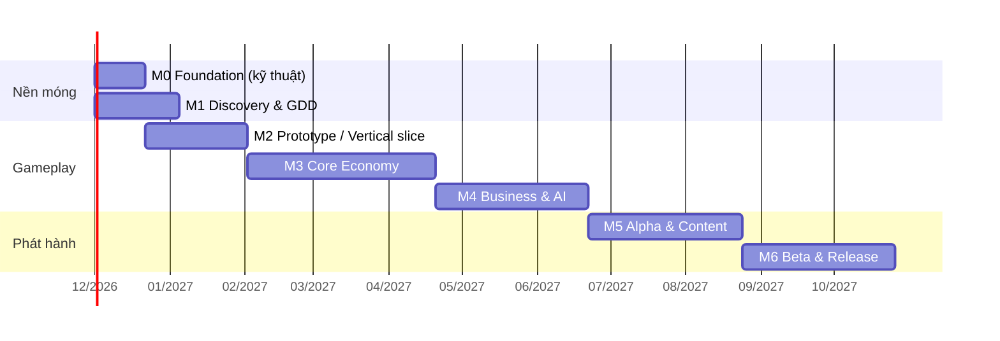

# Lộ trình phát triển — World Economy: Build Your Empire

> Ước tính cho **1 người phát triển (hoặc nhóm nhỏ) có Claude Code hỗ trợ**, dựa trên hồ sơ concept.
> Tổng thời gian đến bản 1.0: khoảng **10–14 tháng**. Sau 1.0 là các bản cập nhật lớn theo module.
> Kiến trúc chi tiết: xem [`ARCHITECTURE.md`](ARCHITECTURE.md). Quyết định cần chốt: xem [`DECISIONS.md`](DECISIONS.md).

---

## Tổng quan các mốc

| Mốc | Thời gian | Mục tiêu một câu | Điều kiện hoàn thành (exit criteria) |
|-----|-----------|------------------|-------------------------------------|
| **M0** Foundation | 2–3 tuần | Bộ khung kỹ thuật chạy được, có test & CI | Chạy headless 365 tick rỗng; CI xanh; save/load v1 khứ hồi được state rỗng |
| **M1** Discovery & GDD | 3–5 tuần (song song M0) | Chốt thiết kế & dữ liệu mẫu | GDD v1, mô hình kinh tế trên bảng tính, danh sách MVP, wireframe 8 màn hình |
| **M2** Prototype | 4–6 tuần | **Vertical slice**: một chuỗi giá trị chạy từ đầu đến cuối | Scenario test: mua nguyên liệu → vận chuyển → sản xuất → bán → thu tiền → báo cáo, pass |
| **M3** Core Economy | 8–12 tuần | Kinh tế "sống": cung cầu, giá, tồn kho, sản xuất, tài chính cơ bản | Chạy 10 năm không vỡ bất biến; giá ổn định trong biên; 3 báo cáo tài chính đúng |
| **M4** Business & AI | 6–10 tuần | Có đối thủ, hợp đồng, sự kiện, công ty con | 5 AI chơi 10 năm tự động, ít nhất 1 phá sản, 1 tăng trưởng mạnh; sự kiện tác động đo được |
| **M5** Alpha & Content | 6–10 tuần | Đủ nội dung bản 1.0, đủ 8 màn hình | 50 quốc gia, 30–50 hàng hóa; save migration; người ngoài chơi được 2 giờ không cần hướng dẫn miệng |
| **M6** Beta & Release | 6–10 tuần | Ổn định, tutorial, phát hành Steam | Tiêu chí phát hành trong concept (mục cuối file này) |

---

## M0 — Foundation (kỹ thuật)

Mục tiêu: dựng "đường ray" để mọi tính năng sau chỉ việc cắm vào.

- [ ] Khởi tạo project Godot 4.x, `.gitignore`, cấu trúc thư mục theo ARCHITECTURE §3
- [ ] Cài **gdUnit4**, chạy test headless từ dòng lệnh
- [ ] GitHub Actions: validate data → unit test → (nightly) export Windows
- [ ] `core/types`: `Money`, `UnitPrice`, `Quantity`, `GameDate`, `EntityId` + test đầy đủ (làm tròn, overflow, cộng trừ khác tiền tệ → lỗi)
- [ ] `core/util`: `RngStream` (derive seed theo system), `Result`, `Logger`
- [ ] `content`: `ContentRegistry`, `ContentLoader` (base → mods), `SchemaValidator`, `tools/validate_data.gd`
- [ ] `kernel`: `Simulation`, `SimClock`, `SimPhase`, `SimSystem`, `SimCommand`, `CommandQueue`, `TickContext`, `WorldState`, `SimModule`, `ModuleRegistry` (sắp xếp theo dependency, phát hiện vòng)
- [ ] `kernel/modifiers`: `Modifier`, `ModifierStack` + test
- [ ] `persistence`: `SaveService` (JSON + gzip, header version), khung migration
- [ ] `app`: `GameSession` (tốc độ, pause, ngân sách ms/frame), `SimBridge`
- [ ] `tools/lint_architecture.gd`: cấm `extends Node` / tham chiếu `ui/` trong `kernel/` và `modules/*/sim/`
- [ ] `CLAUDE.md` hoàn chỉnh (đã có bản đầu)

**Exit:** `godot --headless` chạy 365 tick với 1 module "dummy" đăng ký system DAILY/MONTHLY; test xanh trên CI.

---

## M1 — Discovery & GDD (song song M0)

- [ ] Chốt các quyết định thiết kế trong [`DECISIONS.md`](DECISIONS.md) (điểm bắt đầu, mục tiêu chơi, phong cách hình ảnh...)
- [ ] GDD theo mảng trong `docs/gdd/`: `economy.md`, `production.md`, `logistics.md`, `finance.md`, `ai.md`, `events.md`, `ui-ux.md`
- [ ] Mô hình kinh tế trên **bảng tính** trước khi code: công thức cung/cầu/giá, thử 24 tháng với 3 hàng hóa, tìm tham số không dao động phi thực tế
- [ ] Hệ thống tài khoản kế toán (chart of accounts) tối giản cho MVP
- [ ] Danh sách dữ liệu prototype: **8 quốc gia** (VNM, BRA, USA, CHN, IND, AUS, SAU, DEU) × **12 hàng hóa** (cà phê, gạo, đậu nành, lúa mì, quặng sắt, đồng, than, dầu thô, thép, phân bón, cà phê rang xay, thực phẩm đóng gói)
- [ ] Wireframe 8 màn hình chính + bố cục HUD (bản đồ giữa, top bar, nav trái, panel phải, ticker dưới)
- [ ] Viết JSON Schema cho: commodity, country, recipe, facility, transport, event, ai_profile, scenario

**Exit:** GDD v1 được duyệt; backlog M2–M3 được chia thành issue trên GitHub.

---

## M2 — Prototype / Vertical slice

Mục tiêu: chứng minh **vòng lặp cốt lõi vui và đúng** trước khi đầu tư đồ họa.

**Module tối thiểu:** `world`, `market`, `inventory`, `production`, `logistics`, `trade`, `finance` (bản rút gọn).

- [ ] `world`: nạp 8 quốc gia, tỷ giá cố định, cảng chính
- [ ] `market`: giá theo cung cầu đơn giản (DetailedMarketModel bản 1), lệnh mua/bán với market maker (có trượt giá theo khối lượng)
- [ ] `inventory`: kho theo quốc gia, tồn theo lô, giá vốn bình quân gia quyền
- [ ] `production`: 1 chuỗi — **cà phê nhân → cà phê rang xay**, BOM, công suất, hao hụt, chi phí
- [ ] `logistics`: tuyến biển giữa các cảng, thời gian = khoảng cách / tốc độ, phí theo tấn
- [ ] `trade`: bán cho thị trường nội địa, ghi doanh thu + công nợ, thu tiền sau N ngày
- [ ] `finance`: sổ cái kép, tiền mặt, doanh thu, giá vốn, chi phí; Income Statement + Balance Sheet tối giản
- [ ] UI thô: bản đồ (polygon đơn giản hoặc ảnh tĩnh + điểm click), panel quốc gia, sàn giao dịch, kho, nút tốc độ
- [ ] Save/load v1 với state thật
- [ ] **Scenario test chuỗi mẫu** (từ concept): mua 1 000 t cà phê nhân ở VNM → chở về nhà máy → rang xay → bán ở DEU → thu tiền → báo cáo lãi lỗ khớp với tính tay

**Exit:** Scenario test pass; chơi thử 30 phút thấy được quyết định "mua lúc giá thấp, trữ kho, bán khi khan hiếm" có ý nghĩa.

---

## M3 — Core Economy

- [ ] `market`: đầy đủ công thức (co giãn giá, thu nhập, mùa vụ, giới hạn biến động), nhập/xuất khẩu giữa quốc gia, `AggregateMarketModel` cho quốc gia ít hoạt động
- [ ] `world`: tăng trưởng GDP, thu nhập, dân số đơn giản; tỷ giá và lãi suất biến động nhẹ
- [ ] Hệ thống **Modifier** áp dụng thật vào sản lượng, nhu cầu, chi phí vận tải, thuế quan
- [ ] `production`: nhiều loại cơ sở (trang trại, mỏ, nhà máy), nâng cấp công suất, bảo trì, khấu hao, lao động
- [ ] `inventory`: hạn sử dụng, hư hỏng, chi phí lưu kho, kho lạnh/kho thường
- [ ] `logistics`: phương thức biển + đường bộ, sức chứa phương tiện, rủi ro trễ/mất hàng, bảo hiểm cơ bản
- [ ] `trade`: hợp đồng mua/bán kỳ hạn đơn giản, AR/AP, chiết khấu
- [ ] `finance`: khoản vay ngân hàng (NPC), lãi, thuế TNDN, Cash Flow Statement, Debt report, Inventory aging; cảnh báo thiếu vốn lưu động; phá sản
- [ ] `tools/balance_runner.gd` + notebook/bảng tính đọc CSV để cân bằng
- [ ] Test bất biến chạy 10 năm × 20 seed trong CI (nightly)

**Exit:** Kinh tế tự vận hành 10 năm khi người chơi không làm gì; giá các hàng hóa dao động trong biên hợp lý; báo cáo tài chính cân.

---

## M4 — Business & AI

- [ ] `corporate`: tập đoàn → công ty con theo quốc gia/ngành, sở hữu %, định giá cơ bản (DCF đơn giản hoặc bội số EBITDA), KPI
- [ ] Hợp nhất báo cáo cơ bản (loại trừ giao dịch nội bộ)
- [ ] `ai`: Utility AI, 5–10 profile tính cách, AI dùng đúng Command như người chơi
- [ ] `world_events`: sự kiện từ JSON (thiên tai, đình công, thuế quan, cấm vận, bùng nổ nhu cầu), sinh modifier, có xác suất theo rủi ro quốc gia
- [ ] Tin tức (News feed) sinh từ domain event + sự kiện
- [ ] Mở rộng: Greenfield, mở chi nhánh nước ngoài (theo bảng "Đầu tư & mở rộng" trong concept)
- [ ] Điều kiện mở khóa (unlock) theo quy mô/uy tín — khung chung để dùng cho Banking/M&A/IPO sau này

**Exit:** Chế độ "AI only" chạy 10 năm cho kết quả đa dạng giữa các seed; người chơi cảm nhận được cạnh tranh.

---

## M5 — Alpha & Content

- [ ] Dữ liệu **50 quốc gia** (có `meta.source`, `ref_year`), **30–50 hàng hóa**, chuỗi giá trị cho từng nhóm (nông sản, khoáng sản, năng lượng, công nghiệp, tiêu dùng)
- [ ] Đủ 8 màn hình: World Map, Country Profile, Company Dashboard, Market Exchange, Factory & Warehouse, Finance Center, Investment Center, News & Events
- [ ] Bản đồ thế giới hoàn chỉnh (polygon quốc gia, bộ lọc tài nguyên/thị trường/công ty, tuyến vận tải)
- [ ] Cảnh isometric cho nhà máy/cảng/kho (mức tối thiểu)
- [ ] Tooltip giải thích thuật ngữ, dashboard theo ngữ cảnh (giảm quá tải thông tin)
- [ ] Save migration thật (đổi schema ít nhất 1 lần và test save cũ)
- [ ] Đa ngôn ngữ vi/en
- [ ] Kịch bản khởi đầu + chế độ chơi tự do (sandbox)
- [ ] Đợt cân bằng lớn #1, playtest nội bộ

---

## M6 — Beta & Release

- [ ] Tutorial theo giai đoạn
- [ ] Tối ưu hiệu năng (profiler, cân nhắc chạy sim trên thread)
- [ ] Tùy chọn âm thanh/đồ họa/độ phân giải, phím tắt
- [ ] Playtest với người ngoài nhóm, vòng sửa lỗi theo phản hồi
- [ ] Tích hợp Steam (GodotSteam: achievement, cloud save), bản demo, trang store
- [ ] Crash report + đính kèm command log để tái hiện lỗi

### Tiêu chí hoàn thành bản phát hành (từ concept)
- [ ] Không có lỗi nghiêm trọng làm mất save hoặc phá vỡ mô phỏng
- [ ] Các phép tính tiền, hàng tồn, sản xuất và báo cáo vượt qua test tự động
- [ ] Có tutorial, hướng dẫn, tùy chọn âm thanh/đồ họa và hỗ trợ độ phân giải PC
- [ ] Có ít nhất một kịch bản đủ dài thể hiện tiến trình từ doanh nghiệp nhỏ đến tập đoàn
- [ ] Được kiểm thử với người chơi bên ngoài nhóm và có vòng sửa lỗi dựa trên phản hồi

---

## Sau 1.0 — cập nhật lớn (mỗi mục = 1 module mới)

| Bản cập nhật | Module | Phụ thuộc |
|--------------|--------|-----------|
| Ngân hàng của người chơi | `banking/` | finance, corporate |
| Vận tải hàng không chi tiết | mở rộng `logistics/` | logistics |
| Thị trường chứng khoán | `stock_market/` | corporate, finance |
| M&A đầy đủ (30% / 51% / 100%, thẩm định, tích hợp sau sáp nhập) | `mergers/` | corporate, finance |
| IPO | `ipo/` | stock_market |
| Chính sách tiền tệ quốc gia | `monetary_policy/` | world, finance |
| Multiplayer | `net/` (lớp app) | kernel (Command + tất định) |
| Hỗ trợ mod cộng đồng | mở `data/mods/` | content |

---

## Quy trình làm việc hằng ngày với Claude Code

1. Mỗi phiên làm **một module / một tính năng** nhỏ, có issue mô tả rõ.
2. Viết/cập nhật test trước hoặc cùng lúc với code.
3. Chạy test + validate data trước khi commit; commit nhỏ, mô tả rõ (checkpoint Git).
4. Không để Claude sửa nhiều module cùng lúc khi chưa có test bao phủ.
5. Mọi quyết định kiến trúc mới → ghi vào `docs/DECISIONS.md`.
6. Cuối mỗi mốc: cập nhật checklist trong file này.
